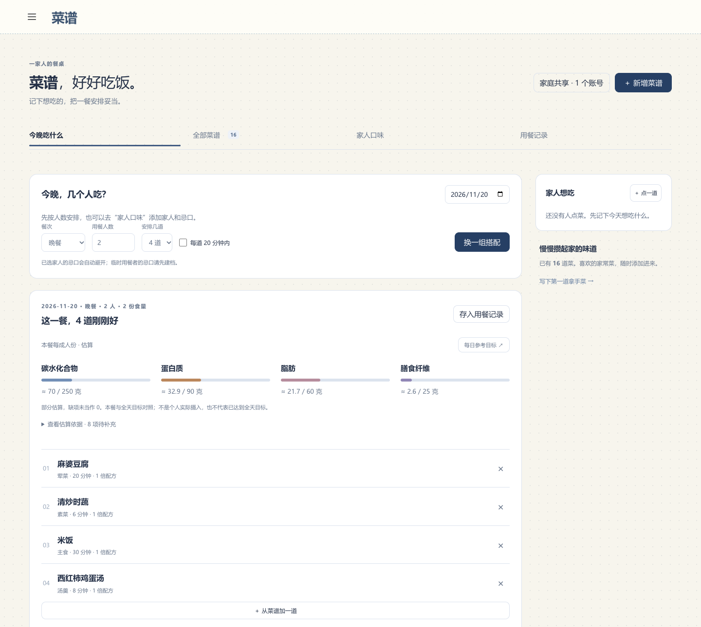
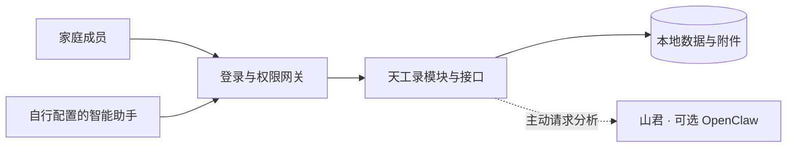

<div align="center">


# 天工录 · Tiangong

**把一家人的日子，慢慢记下来。**

面向家庭、可以自行部署的模块化生活工作台。<br />
让家人和智能助手一起记录生活，让数据成为有用的关心。

[](LICENSE)
[](docs/self-hosting.md)
[](docs/self-hosting.md)
[](CHANGELOG.md)

[功能一览](#功能一览) · [快速开始](#快速开始) · [AI 协作](#ai-协作) · [部署文档](docs/self-hosting.md) · [参与贡献](CONTRIBUTING.md)

</div>

---

## 为一个家，留一张共同的工作台

**天工录为已经部署 OpenClaw、Codex、WorkBuddy 等智能助手的家庭，提供一套可由人和 AI 协作管理的模块化工作台：把家庭成员的体检健康、记账预算、运动饮食、待办笔记、旅行足迹与人际往来记录在一起，在明确授权的范围内回顾和分析，让日常安排更从容，也让重要的人和事被好好记住。**

你也可以先把它当作普通的家庭记录工具。日常查询、统计、餐单与营养估算在本地完成；需要分析时，再接入自己的智能助手。

每位家庭成员拥有独立账号和个人空间，一家人可以共享厨房、提出想吃的菜、安排今晚的餐桌。人际模块帮助你记录生命中出现过的人、相识与往来，在生日和需要维系的时候，及时想起彼此。

## 功能一览

| 模块 | 可以做什么 |
| :--- | :--- |
| **今日 · 待办** | 查看日程与待办，按日期安排事情，把没有日期的事项留在便签中。 |
| **笔记 · 工作** | 记录想法、工作与日常，使用标签组织内容，保留可回顾的生活线索。 |
| **家庭账本** | 记录收支、账户、预算与债务，整理凭证和收款；金额使用整数分计算。 |
| **健康 · 运动** | 整理健康档案、体检信息与运动记录；按成员授权，将必要的健康摘要用于饮食分析。 |
| **家庭菜谱** | 家人点菜、记录忌口，按人数与食量组合餐单、汇总采购量，保存和确认用餐记录。 |
| **营养分析** | 估算碳水化合物、蛋白质、脂肪与膳食纤维；自设目标，结合近期餐单与健康摘要请求山君分析。 |
| **人际往来** | 记录亲友、相识经历与联系记录，查看生日和维系提醒，记住生命中重要的人。 |
| **旅行 · 宝物** | 留下旅行足迹，整理值得珍藏的物品与故事。 |
| **家庭账号** | 管理员、成员与体验账号；个人记录隔离，家庭厨房按成员关系共享。 |
| **随处使用** | 经典、手帐两套主题，适配电脑和手机浏览器，可添加到手机主屏幕。 |

### 从“今晚吃什么”开始

选好谁来吃饭、几个人、吃多少，让家人提出想吃的菜，再把餐单变成采购清单和用餐记录。内置 **15 道基础菜谱**作为起点，也可以随时新增自己的拿手菜，慢慢攒出一个家的味道。



<sub>公开版手帐主题，使用隔离环境中的虚构示例。截图中的营养目标仅用于演示，可以自行修改。</sub>

记录积累后，可以请山君结合近期饮食习惯、忌口和主动共享的健康摘要给出建议，例如提醒增加全谷物或调整食物搭配。营养数值基于食材与配方估算，不等于个人实际摄入量；缺少记录不会被当作零摄入。分析用于营养科普和生活管理，不替代诊疗或医嘱。

## 快速开始

当前首发范围为 **Web 应用 + Python 服务**，支持 macOS、Linux。需要 **Python 3.11+** 和 **Node.js 20+**；Node.js 仅用于构建浏览器资源。

下载源码、进入项目目录后运行：

```sh
python3 -m venv .venv
. .venv/bin/activate
python -m pip install -r requirements.txt
npm ci
npm run build

# 将运行数据放在源码仓库与网盘同步目录之外。
export TIANGONG_STATE_DIR="$HOME/.local/share/tiangong"
python scripts/work_server.py serve
```

打开 **<http://127.0.0.1:8765>**，即可在当前电脑体验。首次启动创建空白个人记录，基础菜谱和公共地图数据随代码提供。

> 本机体验入口没有登录步骤，仅监听回环地址。给家庭成员使用时，请继续按[自行部署指南](docs/self-hosting.md)配置账号网关与 HTTPS；不要直接公开后端端口。

`.env.example` 提供配置参考，程序不会自动读取 `.env`。体验账号使用独立的虚构数据，不会复制管理员资料。

## AI 协作

**天工录提供记录和操作能力，智能助手按你的授权参与整理与分析。**



| 接入方式 | 当前范围 |
| :--- | :--- |
| **手动使用** | 无需模型即可记录、查询、统计、安排餐单与估算营养。 |
| **山君 / OpenClaw** | 已提供可选的餐单分析适配，通过部署者自己的 OpenClaw 调用；需要自行安装与配置。 |
| **Codex / WorkBuddy 等** | 可在配置浏览器或接口访问能力及授权后协作管理；当前没有一键接入插件或统一跨助手协议。 |
| **微信与其他通知渠道** | 复用已有助手的渠道与自动化，自行配置并验证；不是安装天工录就能自动获得微信机器人。 |

山君分析只取当前任务需要的数据；健康摘要须由成员主动授权，不发送医疗附件。普通查询与统计不调用大模型。详见 [AI 与可选集成](docs/integrations.md)。

## 数据由你保管

- **源码与数据分开**：账本、健康附件、账户密码和模型凭据保存在部署者自己的数据目录中。
- **个人与家庭有边界**：私人笔记、账本与健康资料按账号隔离；厨房中的忌口、目标和主动共享的健康摘要对厨房成员可见。
- **单实例写入**：SQLite 与附件由唯一服务实例管理；不要通过网盘多端同步活动数据库。
- **可自行维护**：部署、权限、备份与更新路径均有文档，不要求绑定特定模型供应商。

如果配置外部模型、天气等服务，对应请求会访问该服务；自行部署不等于所有可选能力都离线运行。完整说明见[数据、权限与备份](docs/data-and-privacy.md)。

## 文档导航

| 我想…… | 从这里开始 |
| :--- | :--- |
| 给家人部署并创建账号 | [自行部署与 HTTPS](docs/self-hosting.md) |
| 了解数据在哪里、谁能看见 | [数据、权限与备份](docs/data-and-privacy.md) |
| 连接山君或其他能力 | [AI 与可选集成](docs/integrations.md) |
| 理解目录与服务结构 | [项目结构](docs/architecture.md) |
| 修改代码或提交菜谱 | [贡献指南](CONTRIBUTING.md) |
| 查看变化或反馈安全问题 | [版本记录](CHANGELOG.md) · [安全说明](SECURITY.md) |

## 开发与贡献

欢迎完善部署体验、修复问题、补充菜谱和食材数据。提交家庭场景示例时，请使用虚构数据。

```sh
npm ci
npm run build
python scripts/run_tests.py
```

测试入口自动使用临时数据目录。修改浏览器源码后需要重新构建；构建器生成带内容哈希的资源与校验清单，服务启动时验证资源完整性。当前仓库配置了 Linux / Python 3.11、3.12 的 GitHub Actions 检查。

这是从现有 Web 版整理出的首个开源候选版 **0.1.0**。原生 iOS 客户端、个人运维脚本与私有协作桥不在首发范围内。贡献前请阅读 [CONTRIBUTING.md](CONTRIBUTING.md)。

## 许可与致谢

代码采用 **[MIT License](LICENSE)**，允许使用、修改、分发与商用，请保留版权和许可声明。

地图、食物数据和依赖遵循各自的来源与许可，详见 [THIRD_PARTY_NOTICES.md](THIRD_PARTY_NOTICES.md)。感谢开源工具与公开数据，让一个家的生活记录可以由自己掌握。
